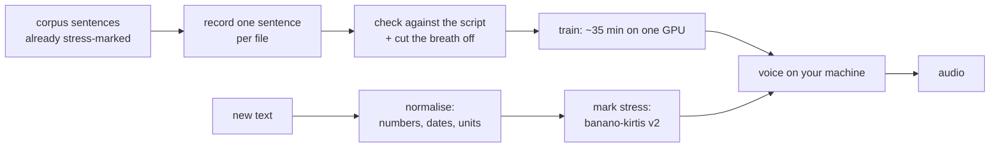

# krapas 🌿 — a Lithuanian voice from an hour of your own reading

Everything needed to turn about an hour of read Lithuanian speech into a text-to-speech voice that runs on
your own machine: which sentences to record and where to get them, how to record so the model does not learn
your breathing, how to check and cut the takes, the training config that worked, and — the part English
tooling does not have — the stress layer that makes *kãsa* and *kasà* two different words.

- **Listen first:** [sudi.lt/balsas](https://sudi.lt/balsas/) — two voices trained this way, next to
  ElevenLabs v3 on the same sentences.
- **The write-up (Lithuanian):** [sudi.lt/gidai/savo-balsas](https://sudi.lt/gidai/savo-balsas) — the same
  path as prose, with the mistakes that cost us a training run.
- **The voice:** [`kristijonas/krapas-Regina`](https://huggingface.co/kristijonas/krapas-Regina) ·
  **the stresser:** [`kristijonas/banano-kirtis-v2`](https://huggingface.co/kristijonas/banano-kirtis-v2)

Vegetable-garden lineage of open Lithuanian speech models: svogūnas 🧅 → paprika 🌶️ → bananas 🍌 →
kmynas 🌱 → krapas 🌿.



## Say something with the published voice

```bash
pip install "omnivoice==0.2.1" torch transformers num2words soundfile numpy
echo 'Prie stoties mus pasitiko 3 vaikai ir vienas šuo.' > text.txt
python3 generate/speak.py text.txt out/
```

The first run downloads the voice (3 GB) and the stresser (2 GB). On an M-series Mac a sentence takes a
couple of seconds; `out/stressed.json` shows what the text became at each stage, which is where you look
when something sounds wrong.

## Make your own voice

```bash
# 1. a reading script: 600 sentences that already carry human stress marks
python3 script/build_script.py --n 600 --out myscript

# 2. record them, one sentence per file, in your browser
python3 record/rec_server.py myscript.json takes

# 3. did you read what is written, and where does the speech start and end
python3 prepare/asr_check.py takes --out takes.asr.json
python3 prepare/build_clips.py --script myscript.json --takes takes --asr takes.asr.json --out clips

# 4. train (rents a GPU, fetches the checkpoints, terminates the GPU on every exit path)
tar -czf train/clips.tgz clips && DATA=train/clips.tgz train/lifecycle.sh

# 5. listen to every saved checkpoint and keep the one that sounds best — usually not the last
python3 generate/speak.py text.txt out-2500/ --ckpt train/results/checkpoint-2500
```

Two settings decided more than anything else in our runs: `--guidance 4` (the library default of 2 ignores
part of the stress marks) and generating **one sentence at a time**. Both are the defaults here.

## What is in here

| | |
|---|---|
| `script/build_script.py` | picks sentences from the VDU stressed corpus, filtered and quota'd (short sentences, questions, exclamations over-represented — that is what a voice lacks) |
| `script/script-a-567.*`, `script-b-289.*` | the scripts we actually read: 567 plain sentences, then 289 with abbreviations, initials and foreign names |
| `record/rec_server.py` | browser recorder, one sentence at a time, all browser audio processing off. Stdlib only |
| `prepare/asr_check.py` | transcribes every take with a local Lithuanian ASR model (Paprika V3 by default — free, offline) |
| `prepare/build_clips.py` | drops the takes where you read something else, cuts the sentence out by energy, resamples to 24 kHz, levels, writes the manifests |
| `train/lifecycle.sh` | rents the GPU, uploads, trains, fetches every checkpoint, and **verifies** the GPU is gone |
| `train/pod_train.sh`, `train_config.json`, `data_config.json` | what runs on the GPU, and the config that worked first time |
| `generate/speak.py` | text file → audio: normalise, stress, generate per sentence, join with pauses |
| `text/normalize_lt.py` | Lithuanian text normalisation: numbers, dates, times, units, currency, ordinals, phone numbers, initials — in the right case |
| `text/kirtis_v2.py` | the stress layer: corpus lexicon first, model for the rest, in context |

## Why Lithuanian needs the stress layer

Lithuanian does not write stress, but stress carries meaning: *mano* is both "my" (*màno*) and "he thinks"
(*mãno*); *kasa* is a braid (*kãsa*), a till (*kasà*) and "digs" (*kãsa*). A voice model that sees only
letters guesses, and a guess is wrong often enough to be heard. So both the training text and anything you
generate later go through the same two steps: numbers become words, then every word gets its stress mark
from context.

That has a pleasant consequence. When a generated sentence sounds wrong, look at `stressed.json` first:
almost always the mark is wrong rather than the voice, and a wrong mark is one line in a dictionary, not a
retrain.

Marking stress before the voice model is Mindaugas Žvirblis's idea: 32 letters are too few for a voice, and
marking stress turns them into about 80 distinct sounds.

## Numbers from the run that produced krapas-Regina

| | |
|---|---|
| Data | 5,124 clips, **3.05 h**, one speaker, from [`meldynamics/liepa-tts`](https://huggingface.co/datasets/meldynamics/liepa-tts) |
| Training | OmniVoice 0.6B, lr 1e-5, 5,000 steps, `batch_tokens` 8192, bf16 |
| Hardware | one A100 80 GB, ~35 min including audio tokenisation |
| Cost | about €12 for the whole project, failed attempts included |
| Chosen checkpoint | 5,000 — picked by listening to 1,000 / 2,500 / 5,000, not by a metric |

With 5k clips there is no eval number that tells you which checkpoint sounds better. Listen.

## Not in here, on purpose

- **The name dictionary.** First names with the state language commission's (VLKK) stress and declension
  are not ours to redistribute, so `text/names/` is empty and names are stressed by the model like any other
  unknown word. The file format is documented in `text/kirtis_v2.py` if you build your own.
- **Our recordings.** The speaker's takes are personal data, not a dataset. The LIEPA corpus is a published
  one, and that is what the Regina voice was trained on.
- **Model weights.** They live on the Hub, not in git.

## Licences

Scripts, configuration and the reading scripts: **CC BY 4.0** (see `LICENSE`). The shipped dictionaries and
the training data have their own provenance and licences — see [`DATA.md`](DATA.md). The voice weights are
CC BY-NC 4.0, inherited from OmniVoice.

Same technology also suits telephone fraud. Your own voice is your decision; anyone else's needs their
consent.
